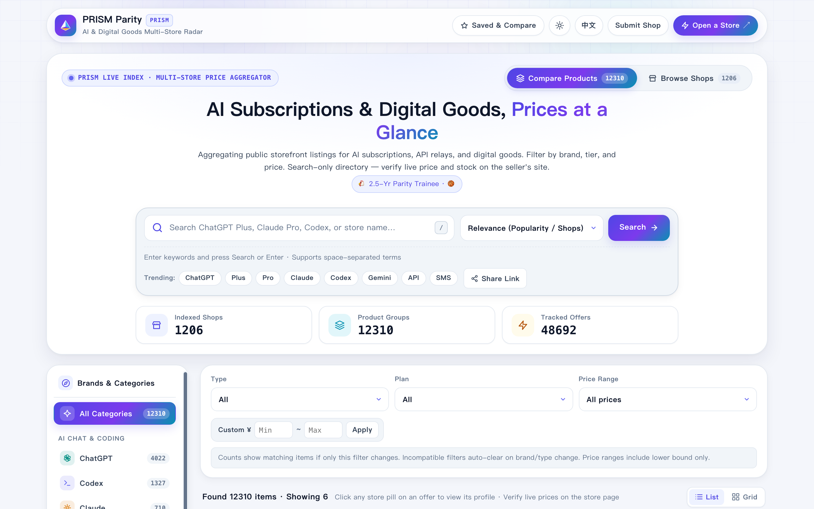
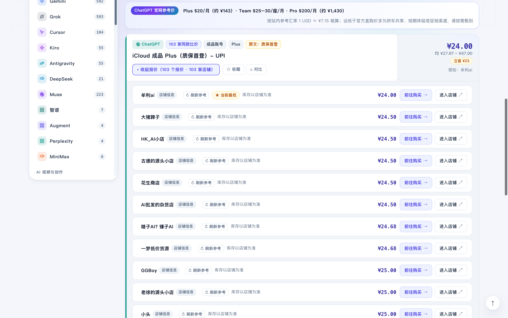
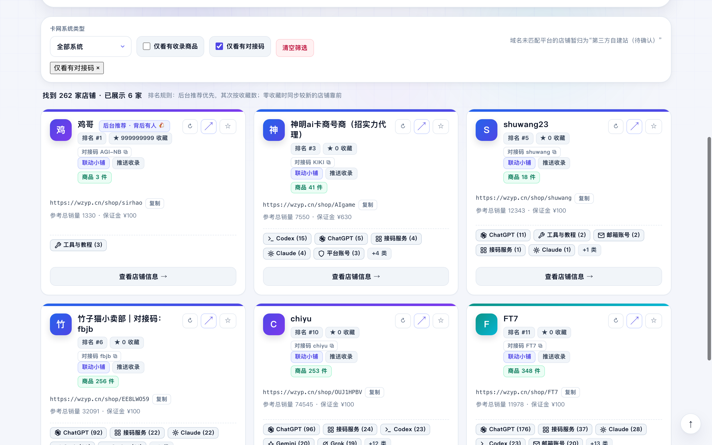
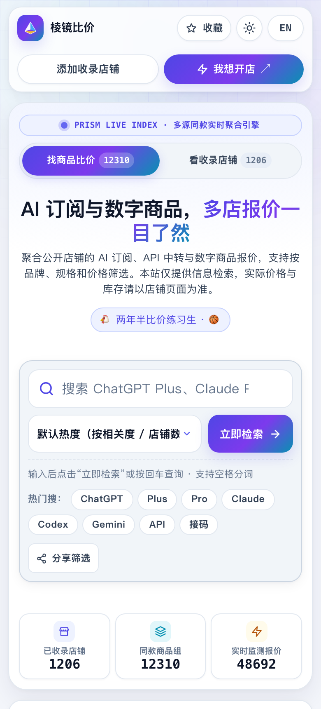
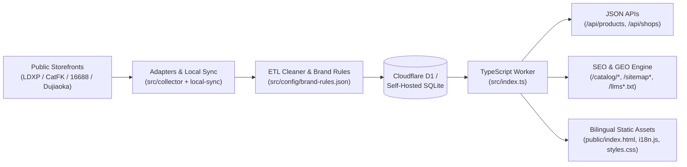

# PRISM Parity (棱镜比价)

[English](README.md) · [简体中文](README.zh-CN.md) · [Live Site](https://parity.sirhao.top) · [LLMs Index](https://parity.sirhao.top/llms.txt) · [Catalog](https://parity.sirhao.top/catalog/)

> **PRISM Parity (棱镜比价)** is an open-source multi-store price comparison engine and store directory for **AI subscriptions, developer tools, API relays, and digital goods**. It aggregates public storefront snapshots across card-store platforms (such as LDXP / 联动小铺, Yunmao / 云猫寄售, 16688, Dujiaoka / 独角数卡, and ACG-Faka / 二次元发卡), normalizes product specifications into unified comparison groups (`ChatGPT`, `Codex`, `Claude`, `Gemini`, `Cursor`, `Grok`, `DeepSeek`, API relays, and more), and helps users discover verified store integration codes.
>
> **Information Boundary:** PRISM Parity is a read-only price intelligence and navigation directory. It does **not** process payments, hold funds, or act as a broker; always verify live pricing, stock, and warranty terms on the source store before ordering.

---

## Live Production & Machine-Readable Endpoints

| Resource | URL | Purpose |
| :--- | :--- | :--- |
| **Live App (zh/en)** | [`https://parity.sirhao.top/`](https://parity.sirhao.top/) | Interactive price comparison workbench, IP-aware `zh`/`en` i18n, mobile-first layout |
| **Knowledge Hub** | [`https://parity.sirhao.top/about/`](https://parity.sirhao.top/about/) | Platform overview, brand entries, integration code usage, and FAQs |
| **AI Pricing Guide** | [`https://parity.sirhao.top/guide/ai-pricing/`](https://parity.sirhao.top/guide/ai-pricing/) | Multi-store comparison guide for ChatGPT, Codex, Claude & Gemini |
| **Integration Codes** | [`https://parity.sirhao.top/catalog/integration-codes/`](https://parity.sirhao.top/catalog/integration-codes/) | Directory of stores with publicly disclosed supplier/distribution integration codes |
| **Static Catalogs** | [`https://parity.sirhao.top/catalog/`](https://parity.sirhao.top/catalog/) | Crawl-friendly HTML directories for brands, product groups, and stores |
| **LLMs Core Index** | [`https://parity.sirhao.top/llms.txt`](https://parity.sirhao.top/llms.txt) | Concise Markdown map for AI search engines and LLM agents (zero-DB cost) |
| **LLMs Full Snapshot** | [`https://parity.sirhao.top/llms-full.txt`](https://parity.sirhao.top/llms-full.txt) | Extended Markdown index with sanitized live pricing & store snapshots |
| **XML Sitemaps** | [`https://parity.sirhao.top/sitemap.xml`](https://parity.sirhao.top/sitemap.xml) | Sharded sitemaps (`sitemap-shops.xml`, `sitemap-products.xml`) |

---

## Screenshots (Live Production UI)

| Bilingual Search Workbench (English) | Multi-Store Price Comparison (ChatGPT) |
| :---: | :---: |
|  |  |
| **Store Directory & Integration Codes** | **Mobile Responsive View (`390px`)** |
|  |  |

---

## Core Capabilities

- **Normalized Multi-Store Price Aggregation (`product_groups`)**: Parses raw product titles and categories via configurable regex rule sets ([`src/config/brand-rules.json`](src/config/brand-rules.json)), splitting brand, form factor (ready account / top-up & redeem code / API relay / SMS verification), tier (`Plus`, `Pro`, `Team`, `Max 5x`, `Max 20x`, `Ultra`), duration, warranty, and region into comparable SKUs.
- **Public Store Directory & Integration Code Extraction**: Automatically detects storefront software (`ldxp`, `catfk`, `16688`, `dujiaoka`, `acg-faka`) and extracts public distribution/supplier integration codes (`对接码` / `分销码`) for resellers and store operators.
- **Bilingual i18n (`zh` / `en`) & Mobile-First UI**: Automatic locale detection via `CF-IPCountry`, `Accept-Language`, cookie, or `?lang=zh|en` query parameter ([`src/i18n/locale.ts`](src/i18n/locale.ts), [`public/i18n.js`](public/i18n.js)), paired with responsive `375px+` mobile cards and drawers.
- **Search & AI Retrieval Optimization (SEO + GEO)**:
  - Server-rendered semantic HTML catalogs (`/catalog/brands/:group/`, `/catalog/products/:key/`, `/catalog/shops/:id/`) with `Schema.org` JSON-LD (`Offer`, `AggregateOffer`, `Product`, `HowTo`, `FAQPage`, `BreadcrumbList`).
  - Standard `/llms.txt` and live `/llms-full.txt` endpoints, plus repository-level [`llms.txt`](llms.txt) for developer and LLM crawlers.
  - Strict privacy sanitization (`hideTelegramContacts`) across public APIs, HTML pages, and LLM indexes.
- **Dual Runtime Deployment**:
  - **Edge Native**: TypeScript on **Cloudflare Workers** + **Workers Static Assets** + **Cloudflare D1** SQLite.
  - **Self-Hosted**: Pre-bundled **Miniflare / workerd** runtime in [`deploy/huoshan/`](deploy/huoshan/README.md) with local persistent SQLite, systemd services, automated online backups, and Nginx/OpenResty reverse proxy support.

---

## Supported Categories & Store Systems

### Product & Brand Coverage

| Domain | Tracked Brands & Keywords |
| :--- | :--- |
| **AI Chat & Coding** | `ChatGPT` (`Plus` / `Pro` / `Team` / `Go`), `Codex` (`CLI` / `Cloud`), `Claude` (`Pro` / `Max 5x` / `Max 20x` / `Code`), `Gemini` (`AI Pro` / `AI Ultra`), `Cursor`, `Kiro`, `Grok` (`SuperGrok`), `DeepSeek`, `Antigravity`, `Augment`, `Perplexity`, `Muse`, `Zhipu (智谱 GLM)`, `Qwen (千问)`, `MiniMax` |
| **AI API & Infra** | `API Relays (中转额度 / One API / New API)`, `Virtual Cards (虚拟卡)`, `Residential & Proxy IPs (代理IP)`, `Email Accounts (邮箱账号)`, `SMS Verification (接码服务)` |
| **Digital Media & Utilities** | `AI Video / Image / Music / Creation`, `Cloud Drives (网盘服务)`, `Media Memberships (影音会员)`, `Software Tools`, `Gaming`, `SIM & Data Cards`, `Tutorials & Digital Assets` |

### Supported Storefront Adapters

| Platform | Key | Collection & Integration Mechanism |
| :--- | :--- | :--- |
| **LDXP (联动小铺)** | `ldxp` | Public store pages & API (`wzyp.cn` / `pay.ldxp.cn`), integration code extraction |
| **Yunmao (云猫寄售)** | `catfk` | Standardized digital consignment storefront snapshot adapter |
| **16688 Platform (16688交易平台)** | `16688` | HTML storefront parser for multi-category wholesale/retail stores |
| **Dujiaoka (独角数卡)** | `dujiaoka` | Open-source self-hosted digital card shop integration via public URL / structured data |
| **ACG-Faka (二次元发卡)** | `acg-faka` | Self-hosted digital storefront index via public URL submission |

---

## Architecture Overview



---

## Quick Start (Local Development)

Requires **Node.js 22+**.

```bash
npm ci
npm run db:migrate:local
npm run dev
```

- **Cloudflare Deployment**: Configure your own D1 `database_id` in [`wrangler.jsonc`](wrangler.jsonc) before running `npm run deploy`.
- **Authenticated Local Endpoints**: Add `INGEST_SECRET` (and admin credentials if testing `/admin/`) in a local `.dev.vars` file. Never commit secrets or `.sqlite` databases.
- **Self-Hosted Deployment**: See [`deploy/huoshan/README.md`](deploy/huoshan/README.md) for `esbuild` bundling (`deploy/huoshan/entry.ts` -> `worker.mjs`) and `workerd` systemd deployment.

### Tests & Verification

```bash
npm test             # Vitest + Cloudflare Workers pool suite
npm run test:sync    # Node integration & sync checks
npm run typecheck    # TypeScript strict check (tsc --noEmit)
```

---

## Public Read & Search Endpoints

| Endpoint | Method | Description |
| :--- | :--- | :--- |
| `/api/products` | `GET` | Paginated, normalized product groups with multi-store price range, brand, form factor, and stock filters |
| `/api/shops` | `GET` | Public store directory filterable by system type (`ldxp`, `catfk`, etc.), stock status, and integration codes |
| `/api/shops/:id` | `GET` | Public store profile (sanitized description, metadata) |
| `/api/shops/:id/products` | `GET` | Public product list for a single indexed store |
| `/api/locale` | `GET` | Resolves active locale (`zh` / `en`) from query, cookie, `CF-IPCountry`, and `Accept-Language` |
| `/llms.txt` & `/llms-full.txt` | `GET` | Machine-readable Markdown summaries for AI search engines and agents |
| `/sitemap.xml` | `GET` | Dynamic XML sitemap index referencing sharded product and store sitemaps |

> **URL Filter Shortcuts on Live Site**:
> - By brand: `https://parity.sirhao.top/?group=ChatGPT`, `/?group=Codex`, `/?group=Claude`, `/?group=Gemini`
> - Stores with integration codes: `https://parity.sirhao.top/?mode=shop&hasIntegrationCode=1`
> - LDXP stores only: `https://parity.sirhao.top/?mode=shop&systemType=ldxp`

---

## Project Structure

- [`src/`](src/) — Worker entrypoint, API handlers, HTML localization middleware, ETL cleaner, collectors, and SEO/GEO generators.
- [`public/`](public/) — Responsive web app (`index.html`, `app.js`, `i18n.js`, `styles.css`), guide pages (`/about/`, `/guide/*`, `/open-store-guide/`), and `robots.txt`.
- [`migrations/`](migrations/) — Cloudflare D1 / SQLite schema migrations.
- [`tests/`](tests/) — Vitest Workers-pool tests (`i18n`, search, collector, SEO, APIs) and Node check scripts.
- [`deploy/huoshan/`](deploy/huoshan/README.md) — Self-hosted Miniflare/`workerd` runner, systemd units, Nginx config, and online SQLite backup scripts.
- [`local-sync/`](local-sync/) — Local synchronization utilities (standalone version: [ldxp-sync-kit](https://github.com/Sirhap/ldxp-sync-kit)).
- [`BRAND-RULES.md`](BRAND-RULES.md) — Specification for brand & category regex rules in `src/config/brand-rules.json`.
- [`INTEGRATION-CODES.md`](INTEGRATION-CODES.md) — Rules for extracting and displaying store integration/distribution codes.

---

## FAQ (Frequently Asked Questions)

### What is PRISM Parity (棱镜比价)?
PRISM Parity is an open-source information aggregation and price comparison platform for AI subscriptions (ChatGPT, Codex, Claude, Gemini, Cursor, DeepSeek, Grok), API relays, and digital goods sold on public card-store websites.

### Does PRISM Parity sell accounts or process payments?
No. It strictly collects publicly visible catalog snapshots for side-by-side price discovery and store navigation. Users click through to the original store to confirm real-time stock, delivery method, and warranty policies.

### What is a store integration code (店铺对接码 / 分销码)?
On platforms like LDXP (联动小铺), merchants publish supplier/distribution codes so resellers can link upstream inventory into their own storefronts. PRISM Parity parses sanitized public store descriptions to surface and filter valid codes.

### How does the bilingual (`zh` / `en`) localization work?
The Worker inspects `?lang=`, the `ldxp_locale` cookie, `CF-IPCountry` (defaulting `CN`, `HK`, `MO`, `TW` to `zh` and other regions to `en`), and `Accept-Language` to serve localized `<html lang>`, metadata, and client-side dictionaries in [`public/i18n.js`](public/i18n.js).

### Can I self-host without Cloudflare Workers?
Yes. Automated scraping is disabled by default (`AUTO_SYNC_ENABLED=false`), and [`deploy/huoshan/`](deploy/huoshan/README.md) provides a complete self-hosted runtime powered by Node.js, Miniflare/workerd, and local D1 SQLite.

---

## Security, Privacy & License

- See [`SECURITY.md`](SECURITY.md) for secret management, privacy sanitization (`hideTelegramContacts`), and vulnerability reporting.
- See [`CONTRIBUTING.md`](CONTRIBUTING.md) for rule editing and test requirements.
- Licensed under the [MIT License](LICENSE).
