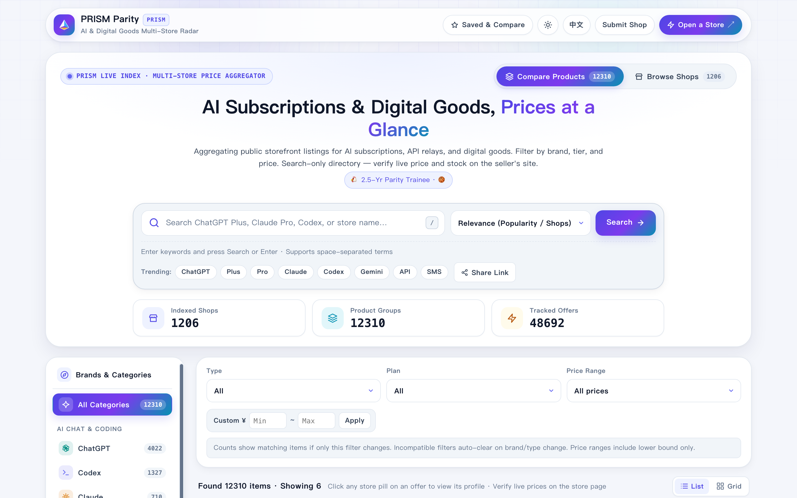
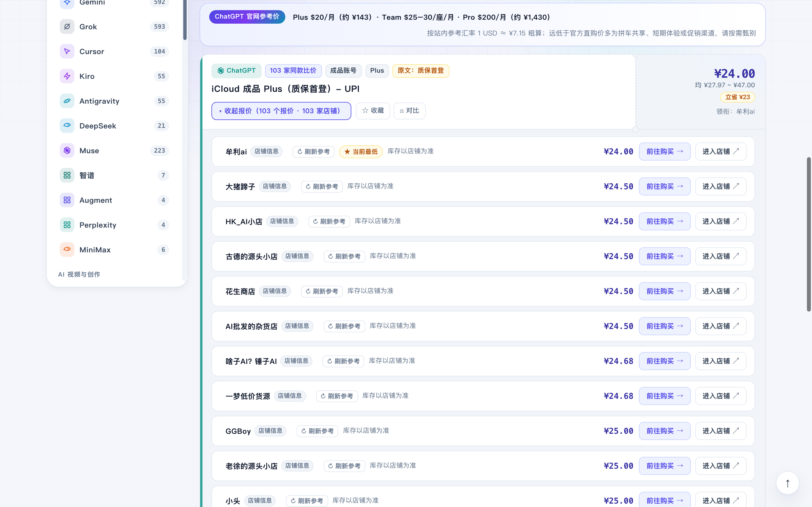
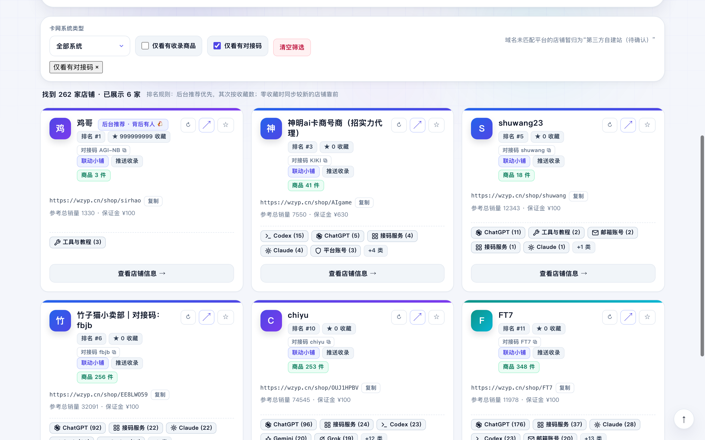
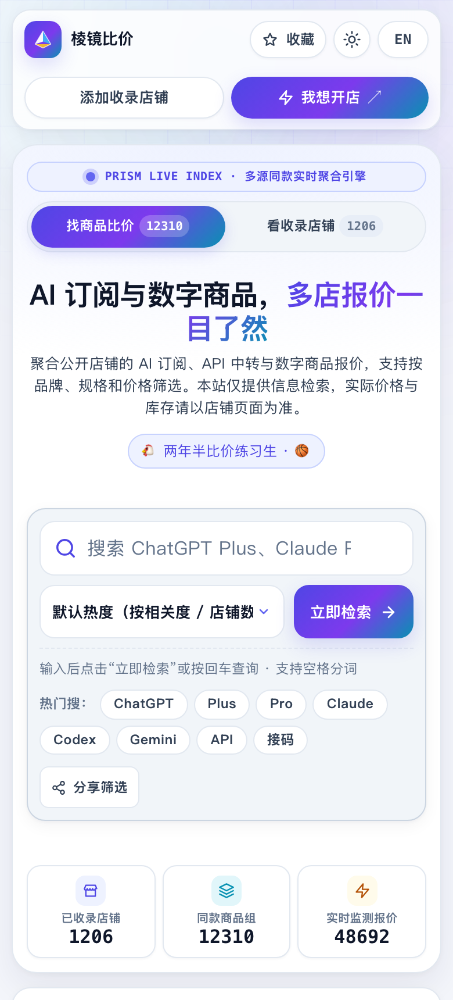
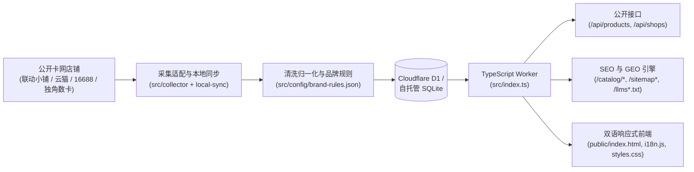

# 棱镜比价 · PRISM Parity

[English](README.md) · [简体中文](README.zh-CN.md) · [线上站点](https://parity.sirhao.top) · [LLMs 知识索引](https://parity.sirhao.top/llms.txt) · [静态目录](https://parity.sirhao.top/catalog/)

> **棱镜比价（PRISM Parity）** 是一个面向 **AI 订阅、编程工具、API 中转与数字商品** 的开源多店比价与卡网店铺收录导航引擎。项目基于 TypeScript、Cloudflare Workers、Static Assets 与 D1 构建，同时支持通过 [`deploy/huoshan/`](deploy/huoshan/README.md) 在自托管服务器以 Miniflare / `workerd` 运行。
>
> **服务边界声明**：网站仅做公开店铺信息收录与参考价格检索，不参与任何交易、代购或资金结算；实时价格、库存与售后条款请以源站店铺页面为准。

---

## 在线入口与机器可读资源

| 资源 | 地址 | 用途说明 |
| :--- | :--- | :--- |
| **实时比价首页** | [`https://parity.sirhao.top/`](https://parity.sirhao.top/) | 找商品比价 / 看收录店铺双模式工作台，支持中英双语与手机端适配 |
| **导航百科与 FAQ** | [`https://parity.sirhao.top/about/`](https://parity.sirhao.top/about/) | 热门 AI 品牌比价入口、对接码说明与常见问题汇总 |
| **AI 订阅比价指南** | [`https://parity.sirhao.top/guide/ai-pricing/`](https://parity.sirhao.top/guide/ai-pricing/) | ChatGPT、Codex、Claude、Gemini 等成品号/代充/中转对比参考 |
| **店铺对接码专题** | [`https://parity.sirhao.top/catalog/integration-codes/`](https://parity.sirhao.top/catalog/integration-codes/) | 汇总已识别公开对接码（分销码）的卡网店铺并支持一键复制 |
| **开店三步图解** | [`https://parity.sirhao.top/open-store-guide/`](https://parity.sirhao.top/open-store-guide/) | 联动小铺注册开店、复制对接码到关联货源的图文指引 |
| **静态目录索引** | [`https://parity.sirhao.top/catalog/`](https://parity.sirhao.top/catalog/) | 面向搜索引擎与静态抓取的品牌、商品组与店铺全量目录 |
| **LLMs 核心索引** | [`https://parity.sirhao.top/llms.txt`](https://parity.sirhao.top/llms.txt) | 零 D1 读取开销的大模型 / AI 搜索标准 Markdown 索引 |
| **LLMs 扩展快照** | [`https://parity.sirhao.top/llms-full.txt`](https://parity.sirhao.top/llms-full.txt) | 包含脱敏实时统计、热门品牌报价与精选对接码店铺快照 |
| **XML Sitemap** | [`https://parity.sirhao.top/sitemap.xml`](https://parity.sirhao.top/sitemap.xml) | 分片站点地图（`sitemap-shops.xml`、`sitemap-products.xml`） |

---

## 实际网页截图

| 英文双语首页（IP 自动切换 / 实时聚合工作台） | 同款多店比价明细（展开多店横向对比与官网参考价） |
| :---: | :---: |
|  |  |
| **看收录店铺与对接码筛选** | **手机端响应式适配（`390px` 视口）** |
|  |  |

---

## 核心能力与技术亮点

- **同款规格归一化与多店聚合（`product_groups`）**：通过可配置正则规则（[`src/config/brand-rules.json`](src/config/brand-rules.json)）清洗商品名称与店铺分类，拆分品牌、商品形态（成品账号 / 代充兑换码 / API 中转 / 接码服务）、套餐档位、时长、质保、是否接码与地区属性，实现跨店横向比价。
- **公开店铺收录与对接码自动识别**：自动识别店铺系统（联动小铺 `ldxp`、云猫寄售 `catfk`、16688 交易平台 `16688`、独角数卡 `dujiaoka`、二次元发卡 `acg-faka`），并在保护隐私前提下提取规范标注的店铺对接码（分销码）。
- **中英文双语国际化（`zh` / `en`）与手机端响应式适配**：服务端依据 `?lang=`、`Cookie`、`CF-IPCountry` 与 `Accept-Language` 自动切换中英文界面与页面元数据（[`src/i18n/locale.ts`](src/i18n/locale.ts)、[`public/i18n.js`](public/i18n.js)），并对 `375px` 移动端做了双行顶栏、紧凑指标卡与卡片流适配。
- **原生 SEO 与 GEO（生成式引擎优化）能力**：内置 `Schema.org` 结构化数据（`Offer`、`AggregateOffer`、`HowTo`、`FAQPage`、`BreadcrumbList`）、动态分片 Sitemap、`/llms.txt`、`/llms-full.txt` 与隐私脱敏过滤（自动隐藏 Telegram 等私人联系方式）。
- **双运行时部署架构**：原生支持 **Cloudflare Workers + D1**，亦可在独立 Linux 服务器使用 [`deploy/huoshan/`](deploy/huoshan/README.md) 中的固定版 Miniflare / `workerd` + 本地持久化 SQLite + systemd + 在线备份运行。自动采集默认关闭（`AUTO_SYNC_ENABLED=false`），支持管理员通过鉴权接口推送店铺快照。

---

## 收录商品范围与支持卡网系统

### 商品与品牌分类

- **AI 对话与编程订阅**：`ChatGPT`（Plus / Pro / Team / Go）、`Codex`、`Claude`（Pro / Max 5x / Max 20x / Claude Code）、`Gemini`（AI Pro / AI Ultra）、`Cursor`、`Kiro`、`Grok`、`DeepSeek`、`Antigravity`、`Augment`、`Perplexity`、`Muse`、`智谱`（GLM）、`千问`、`MiniMax`
- **API 中转与基础设施**：`中转`（One API / New API 等接口额度兑换）、`虚拟卡`、`代理IP`、`邮箱账号`、`接码服务`、`云手机`
- **数字内容与工具会员**：`AI视频`、`AI绘图`、`AI音乐`、`AI创作`、`软件工具`、`数字素材`、`工具教程`、`手机卡`、`游戏商品`、`影音会员`、`社交会员`、`网盘服务`、`生活优惠`

### 支持的卡网系统

| 系统名称 | 内部标识 | 收录与特性说明 |
| :--- | :--- | :--- |
| **联动小铺** | `ldxp` | 支持公开店铺页与标准商品接口（`wzyp.cn` / `pay.ldxp.cn`），自动提取店铺对接码 |
| **云猫寄售** | `catfk` | 支持标准化寄售店铺快照采集与商品归一化入库 |
| **16688交易平台** | `16688` | 支持平台店铺网页解析，适合源头货源与多品类数字商品商家 |
| **独角数卡** | `dujiaoka` | 支持独立域名开源发卡站公开地址提交与结构化解析 |
| **二次元发卡** | `acg-faka` | 支持公开站点地址提交并纳入店铺与商品索引 |

---

## 系统架构图



---

## 本地运行与测试

需要 **Node.js 22** 或更高版本：

```bash
npm ci
npm run db:migrate:local
npm run dev
```

- 部署到 Cloudflare 前，请在 [`wrangler.jsonc`](wrangler.jsonc) 填写你自己的 D1 数据库 ID。
- 本地调试受保护写接口需要在项目根目录 `.dev.vars` 配置 `INGEST_SECRET`（切勿提交真实密钥或数据库文件）。
- 自托管服务器构建与发布流程见 [`deploy/huoshan/README.md`](deploy/huoshan/README.md)。

### 自动化检查

```bash
npm test             # Vitest + Cloudflare Workers Pool 测试套件
npm run test:sync    # Node 同步与接口校验脚本
npm run typecheck    # TypeScript 类型检查
```

---

## 常用公开接口与直达筛选参数

- **公开只读接口**：
  - `GET /api/products` 可检索聚合商品组。公开分页最多展示 300 个匹配结果，`visibleTotal` 为可浏览数量。完整分页需传 `full=1` 并使用同步密钥进行 Bearer 鉴权。
  - `GET /api/shops`：按卡网系统、在售状态与是否含对接码筛选已收录店铺
  - `GET /api/shops/:id` 与 `GET /api/shops/:id/products`：获取单店脱敏档案与在售商品
  - `GET /api/locale`：返回当前识别的站点语言（`zh` / `en`）
- **常用前台检索直达链接**：
  - 按品牌比价：`https://parity.sirhao.top/?group=ChatGPT`、`/?group=Codex`、`/?group=Claude`、`/?group=Gemini`
  - 筛选含对接码店铺：`https://parity.sirhao.top/?mode=shop&hasIntegrationCode=1`
  - 仅看联动小铺店铺：`https://parity.sirhao.top/?mode=shop&systemType=ldxp`

---

## 仓库目录结构

- [`src/`](src/)：Worker 入口、API 路由、地区语言识别、采集清洗、品牌规则与 SEO/GEO 生成器
- [`public/`](public/)：前端页面（`index.html`、`app.js`、`i18n.js`、`styles.css`）、`/about/`、`/guide/*`、`/open-store-guide/` 与 `robots.txt`
- [`migrations/`](migrations/)：D1 / SQLite 数据库迁移脚本
- [`tests/`](tests/)：Vitest Workers 单元测试与 Node 集成检查脚本
- [`deploy/huoshan/`](deploy/huoshan/README.md)：火山服务器自托管 Miniflare/`workerd`、systemd 服务与在线备份脚本
- [`local-sync/`](local-sync/)：本地同步工具，独立仓库见 [ldxp-sync-kit](https://github.com/Sirhap/ldxp-sync-kit)
- [`BRAND-RULES.md`](BRAND-RULES.md)：商品分类规则与维护说明
- [`INTEGRATION-CODES.md`](INTEGRATION-CODES.md)：店铺对接码提取与展示规范

---

## 常见问题（FAQ）

**1. 棱镜比价与源站卡网有什么关系？**  
棱镜比价仅聚合公开店铺页面的商品标题、参考价格与库存状态，不代表任何商家背书，也不代收货款。

**2. 为什么部分商家能在搜索结果看到「对接码」？**  
联动小铺等平台支持货源分销对接码；系统会在公开店铺简介中识别合规标注的对接码并脱敏展示，方便商家与分销者快速对接。

**3. 网站如何决定默认显示中文还是英文？**  
优先读取 URL 参数 `?lang=` 与用户切换 Cookie，其次依据 `CF-IPCountry`（`CN`、`HK`、`MO`、`TW` 默认简体中文，其余地区默认英文）与 `Accept-Language`。

---

## 安全与开源协议

- 安全规范与隐私边界见 [`SECURITY.md`](SECURITY.md)，贡献说明见 [`CONTRIBUTING.md`](CONTRIBUTING.md)。
- 开源协议：[MIT License](LICENSE)
